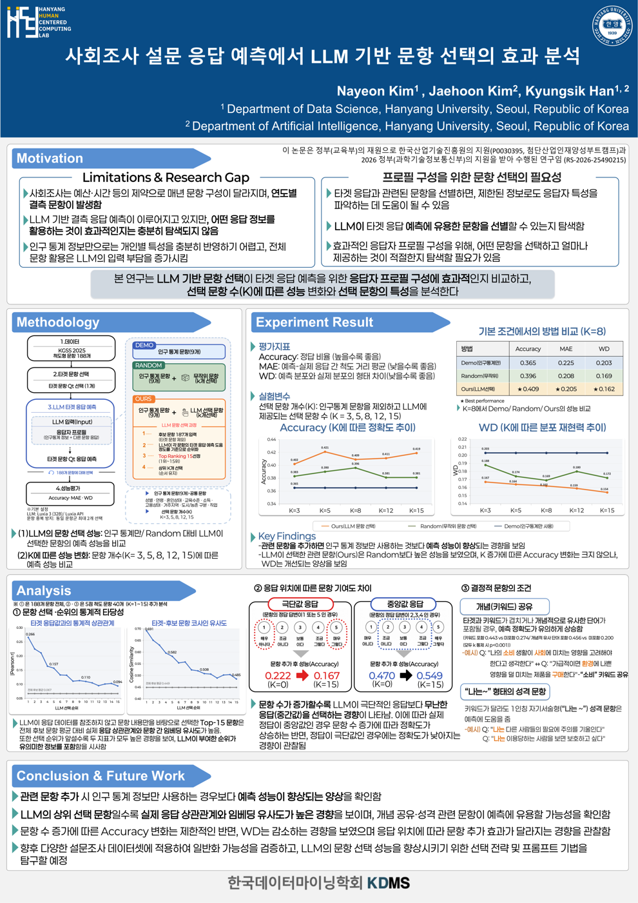
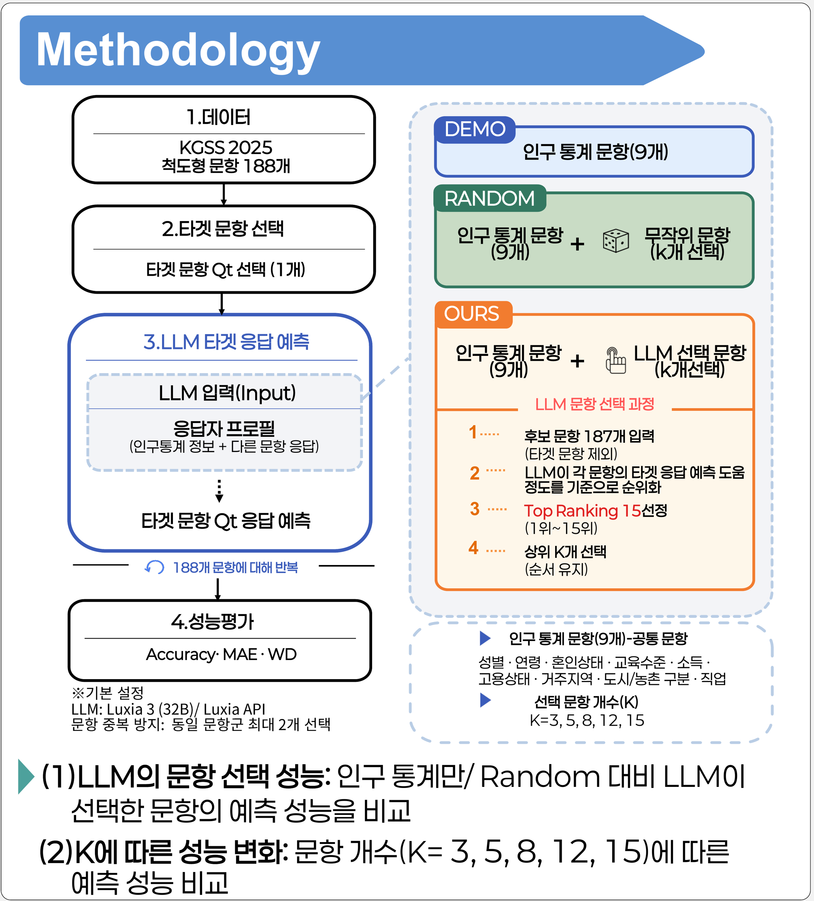
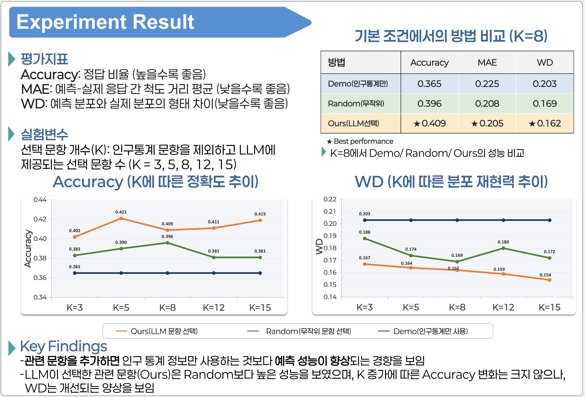
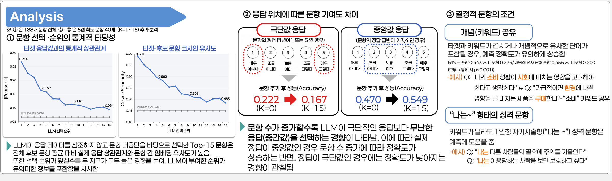

# 사회조사 설문 응답 예측에서 LLM 기반 문항 선택의 효과 분석

> **한국데이터마이닝학회(KDMS) 포스터 발표** · 📄 [포스터 PDF](docs/poster_KDMS.pdf)
> Nayeon Kim, Jaehoon Kim, Kyungsik Han · 한양대학교 Human-Centered Computing Lab

사회조사는 매년 문항 구성이 바뀌어서 **어떤 해에는 특정 질문이 빠지는 결측 문항**이 생깁니다. 이 연구는 그 빠진 질문에 대한 응답을 LLM으로 예측하려고 합니다.

## 한눈에 보기: 무엇을 예측하고, LLM은 무엇을 고르나요?

설문 문항이 188개 있다고 해 봅시다. 실험은 다음처럼 진행됩니다.

1. **맞힐 문항 1개(타겟)를 정합니다.**
   예) *"나의 소비 생활이 사회에 미치는 영향을 고려해야 한다고 생각한다"*
2. **나머지 187개 문항 중에서, 타겟을 맞히는 데 도움이 될 문항 K개를 고릅니다.** ← **LLM이 하는 일**
   예) *"가급적이면 환경에 나쁜 영향을 덜 미치는 제품을 구매한다"* 등
   LLM은 **문항의 내용(질문 텍스트)만 보고** 고릅니다. 응답자의 답은 보지 않습니다.
3. **응답자 한 명마다, 고른 K개 문항에 대한 그 사람의 실제 답을 프로필에 넣습니다.**
   ```
   (설명용 가상 예시 · 실제 프롬프트를 간략화)
   [응답자 프로필]
   - 인구통계 9개: 성별 여성, 연령 34세, 학력 대졸, ...
   - Q. 가급적이면 환경에 나쁜 영향을 덜 미치는 제품을 구매한다 → A. 조금 그렇다
   - Q. (LLM이 고른 다른 문항) → A. (이 사람의 실제 답)
   ...
   [질문] 이 사람은 "나의 소비 생활이 사회에 미치는 영향을 고려해야 한다"에 뭐라고 답했을까?
   ```
4. **LLM이 타겟 문항의 답을 예측하고, 실제 답과 비교합니다.**
5. **188개 문항을 하나씩 타겟으로 바꿔 가며 1~4를 반복합니다.**

즉 **LLM이 고르는 것은 "사람"이나 "답"이 아니라 "어떤 질문을 참고 자료로 보여줄지"**입니다. 이렇게 LLM이 고른 문항(**Ours**)을 무작위로 고른 문항(**Random**), 그리고 인구통계만 쓴 경우(**Demo**)와 비교했습니다.

> 연구 질문
> 1. 응답자 프로필에 이 사람이 답한 어떤 **다른 문항**을 넣어야 예측이 잘 되는가?
> 2. LLM이 그 문항을 **직접 골라 줄 수 있는가?**
> 3. 문항을 **몇 개(K)** 넣는 게 적당한가?

데이터는 KGSS(한국종합사회조사) 2025의 척도형 문항 188개를 사용했습니다.

<p align="center"></p>

---

## 연구 과정: 시행착오에서 문제 재정의까지

이 저장소에는 최종 실험뿐 아니라, 그 설계에 도달하기까지의 **탐색 실험 21개**가 함께 들어 있습니다.

### 1단계: LLM이 답을 직접 맞히게 하기 ([`01_exploration/`](01_exploration))

처음에는 인구통계 프로필을 주고 LLM이 응답을 바로 생성하게 했습니다. 그러자 **20명 중 19명에게 같은 답을 내는 쏠림 현상(mode collapse)**이 나타났습니다. 이를 풀기 위해 다음을 하나씩 바꿔 봤습니다.

| 시도 | 결과 |
|---|---|
| 프로필 형식: JSON 대 줄글, 수치 대 LLM 서술 | 쏠림은 일부 완화, 정확도 개선 없음 |
| 생성 온도: 0.3 / 0.7 / 1.0 | 0.3이 최적. 온도를 올리면 노이즈만 증가 |
| few-shot 예시: 무작위 응답자, 인구통계 유사 응답자 | 예시의 최빈값을 따라 하는 경향 |
| 추가 문항 선택: 상관, 임베딩, 이론적 개념군, 무작위 | 선택 방식 간 유의차 없음 |
| LLM이 비슷한 응답자를 고르고, 그들의 실제 답을 사용 | ML 기준선(Ridge, RF, GBM 등)과 유의차 없음 |

**→ 대부분의 설계가 단순히 "최빈값으로 채우기"를 안정적으로 넘지 못했습니다.**

이 과정에서 세 가지를 발견했습니다.
- **LLM은 극단적인 응답을 피하고 중간값이나 특정 보기로 쏠리는 경향**을 보였습니다. 실제 응답의 약 18%가 양 끝 보기(예: "매우 그렇다")였지만, LLM 예측에서는 2~7%에 그쳤습니다. 개인차가 큰 응답일수록 맞히기 어려운 이유 중 하나입니다.
- 성능을 끌어올린 조건에는 공통적으로 **"타겟과 관련된 다른 문항에 대한 본인의 실제 응답"**이 들어 있었습니다.
- 사실상 같은 질문인 쌍둥이 문항이 섞이면 **정보 누출(leakage)**이 생깁니다. 그래서 같은 문항군은 최대 2개로 제한하는 규칙을 만들었습니다.

### 2단계: 질문을 바꾸기 ([`02_llm_question_selection/`](02_llm_question_selection))

그래서 질문을 *"LLM이 답을 잘 맞히는가?"*에서 **"LLM이 예측에 유용한 문항을 잘 고르는가?"**로 바꿨습니다.

---

## 방법

<p align="center"></p>

- **Demo**: 인구통계 문항 9개만 사용
- **Random**: 인구통계 문항 9개 + 무작위로 고른 문항 K개
- **Ours**: 인구통계 문항 9개 + **LLM이 타겟 예측에 도움이 되는 순서로 고른 상위 K개**
- 188개 문항 각각을 타겟으로 반복하고, K = 3, 5, 8, 12, 15에서 비교했습니다.
- 평가 지표는 Accuracy, MAE, WD(Wasserstein Distance, 분포 재현력)입니다.
- 모델은 Luxia 3 (32B), temperature 0.3을 사용했습니다.

## 결과

<p align="center"></p>

| 방법 (K=8) | Accuracy ↑ | MAE ↓ | WD ↓ |
|---|---|---|---|
| Demo (인구통계만) | 0.365 | 0.225 | 0.203 |
| Random (무작위) | 0.396 | 0.208 | 0.169 |
| **Ours (LLM 선택)** | **0.409** | **0.205** | **0.162** |

- 관련 문항을 추가하면 인구통계만 쓸 때보다 예측 성능이 좋아집니다.
- LLM이 고른 문항(Ours)은 모든 K에서 Random보다 성능이 높습니다.
- K가 늘어도 Accuracy 변화는 크지 않지만, WD는 꾸준히 개선됩니다(0.167 → 0.154).

## 분석

<p align="center"></p>

1. **LLM이 매긴 순위는 의미가 있습니다.** LLM은 응답 데이터를 보지 않고 문항 텍스트만으로 골랐습니다. 그런데도 상위 순위 문항일수록 타겟과의 실제 상관(|r|)과 임베딩 유사도가 높았습니다.
2. **응답 위치에 따라 효과가 다릅니다.** 문항을 늘리면 LLM이 무난한 중간값을 고르는 경향이 생깁니다. 그래서 정답이 중간값일 때는 정확도가 올라가고(0.470 → 0.549), 극단값일 때는 떨어졌습니다(0.222 → 0.167).
3. **결정적 문항에는 공통 조건이 있습니다.** 타겟과 키워드나 개념을 공유하는 문항, 그리고 "나는 ~" 형태의 1인칭 성격 문항이 예측에 특히 도움이 되었습니다.

## 한계와 향후 과제

- 단일 데이터셋(KGSS)과 단일 LLM으로 실험했습니다. 다른 설문 데이터셋에서 일반화 가능성을 검증할 예정입니다.
- 1단계 탐색 실험의 상당수는 소표본(n=20~30)으로 진행되었습니다.
- "같은 문항군 최대 2개" 규칙은 타겟과 실제로 강하게 관련된 문항군까지 일괄 제한합니다. 일부 문항에서는 성능을 낮췄을 수 있습니다.
- 문항 선택 전략과 프롬프트 기법을 개선하는 방향으로 연구를 이어갈 예정입니다.

---

## 저장소 구조

```
.
├── 01_exploration/              # 1단계: 탐색 실험 exp001–021 (2023 KGSS)
├── 02_llm_question_selection/   # 2단계: LLM 기반 문항 선택 최종 실험 (2025 KGSS)
├── scripts/                     # 데이터 전처리
├── figures/                     # README 그림 (포스터에서 발췌)
├── docs/                        # 포스터 PDF
├── data/                        # (git 제외) 데이터 배치 안내만 포함
├── requirements.txt
└── .env.example
```

## 실행 방법

```bash
pip install -r requirements.txt
cp .env.example .env    # LUXIA_API_KEY 입력
# data/README.md 안내에 따라 KGSS 데이터 배치
python 02_llm_question_selection/run_k_sweep.py
```

KGSS 원자료는 재배포 제한이 있어 저장소에 포함하지 않았습니다. 모든 경로는 저장소 루트 기준입니다.

---

## 폴더별 안내

### `02_llm_question_selection/`: 최종 실험 (포스터 결과)

| 파일 | 하는 일 |
|---|---|
| `utils.py` | 공용 함수: 데이터 로딩, 응답 디코딩, LLM 호출 |
| `run_pilot_conditions.py` | 본 실험 전 파일럿. Ours / Random / Demo / 전체 187문항 조건, 질문 원문 대 라벨 형식 비교 |
| `run_k_sweep.py` | **메인 실험.** K = 3, 5, 8, 12, 15에서 Ours / Random / Demo 비교 (포스터 Experiment Result) |
| `run_k_sweep_stat.py` | 비교 방법 추가: 실제 응답 상관(Pearson \|r\|)이 높은 순으로 문항 선택 |
| `run_k_sweep_capped.py` | 공정 비교: 다른 방법에도 "같은 문항군 최대 2개" 규칙 적용 |
| `run_rank_curve_30q.py` | K를 1개씩 늘려 가며(1~15) 성능 변화 추적, 30문항 |
| `run_rank_curve_40q_5point.py` | 위와 같은 방식, 5점 척도 40문항 (포스터 Analysis ②③) |
| `explain_predictions.py` | LLM에게 예측 이유를 설명하게 함 (분석용) |
| `explain_nonobvious_items.py` | 키워드로는 설명되지 않는데 성능을 올린 문항에 대해, 왜 도움이 되는지 LLM에게 설명하게 함 |
| `explain_nonobvious_predictions_before.py` / `_after.py` | 위 사례에서 해당 문항을 추가하기 전(오답)과 후(정답)의 예측 이유 비교 |

### `01_exploration/`: 탐색 실험 (2023 KGSS)

각 실험 폴더에 스크립트와 설계 문서(`config.md`)가 들어 있습니다.

| 실험 | 내용 |
|---|---|
| exp001–002 | 정보 누출 기준 정하기: 상관과 임베딩 유사도로 쌍둥이 문항 판별 |
| exp004–007 | LLM이 답을 직접 생성: 인구통계만 / JSON 대 줄글 / 무작위 예시 / 온도 비교 |
| exp008–012 | 추가 문항 선택 방식 비교(상관, 임베딩, 이론적 개념군, 무작위), 3개 타겟 n=100 |
| exp013 | 최빈값과 kNN 기준선과의 비교 |
| exp014 | 비슷한 응답자 찾기: 인구통계 kNN 대 임베딩 |
| exp015 | 또래 대비 이탈 정도(z-score) 프로필 |
| exp016 | 신뢰(CANTRUST) 문항 대상 줄글 프로필 |
| exp017–019 | LLM이 비슷한 응답자를 고르고, 그 사람들의 실제 답으로 예측 |
| exp020 | 위 방식을 ML 기준선(Ridge, Logistic, RF, GBM)과 비교, 재현성 검증 |
| exp021 | 이전 연도 데이터 활용 파일럿 |

### 기타

| 폴더 | 내용 |
|---|---|
| `scripts/` | KGSS 원자료를 응답자별 질문-답변 형식으로 변환 |
| `figures/` | README 그림 (최종 포스터에서 발췌) |
| `docs/` | 최종 포스터 PDF |
| `data/` | 데이터 배치 안내(`data/README.md`)만 포함 |
